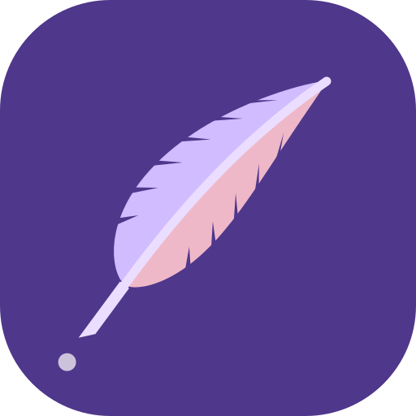
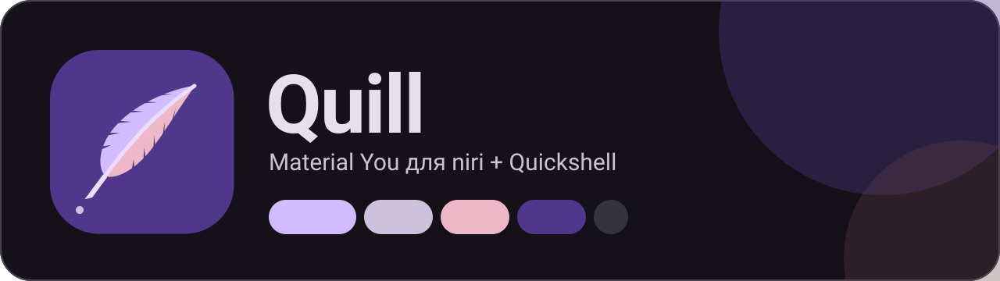

<div align="center">



# Quill

**Material You для niri + Quickshell на Fedora**
<br>
<sub>A complete Material 3 Expressive desktop for the niri compositor, built entirely on Quickshell.</sub>

<br>




</div>

<br>

## ✨ Что это

Весь рабочий стол — **на Quickshell**: никаких waybar, rofi, wofi, mako, swww. Цвета берутся из обоев (Material You / Dynamic Color), а оформление следует системе Material 3 целиком, а не только палитре.

> Выбрал обои → перекрасилась панель, niri, терминал и GTK-приложения.

<br>

## 🎨 Material You — это не только цвет

| Слой | Как сделано |
|---|---|
| **Цвет** | [matugen](https://github.com/InioX/matugen): обои → tonal-палитры → ~30 ролей (`primary`, `on_surface`, `surface_container_high` …). Стили палитры и 3 уровня контраста |
| **Форма** | Шкала скруглений M3: 4 · 8 · 12 · 16 · 20 · 28 · 32 · 48 · full. Кнопки, тайлы и пункты списка морфятся при нажатии и выборе |
| **Типографика** | 15 ролей M3 (display … label): размеры, межстрочный интервал, трекинг; Roboto Flex; emphasized-варианты |
| **Движение** | Токены M3 Expressive: *spatial* (пружина с перерегулированием) и *effects* (цвет, прозрачность) |
| **State layers** | hover 8 %, focus / press 10 % |
| **Elevation** | Тональные поверхности + тени уровней 1–5 |
| **Компоненты** | Search bar, сегментированный список, toggle-тайлы, слайдер Expressive, filter chips, волнистый индикатор, filled-иконки |

<br>

## 🧩 Что внутри

| | Чем сделано |
|---|---|
| 🪟 Композитор | **niri** |
| 📊 Панель | три «островка»: рабочие столы · часы · трей и статус |
| 🔍 Лаунчер | поиск приложений вместо rofi / wofi |
| 🔔 Уведомления | собственный демон вместо mako / dunst |
| 🎛 Центр управления | сеть, тема, «не беспокоить», громкость, яркость, медиа |
| 🔊 OSD | громкость с волнистым индикатором |
| 🖼 Оформление | выбор обоев, стиля палитры и контраста |
| ⏻ Питание | сон · выход · перезагрузка · выключение |
| 🌄 Обои, idle | рисует сам Quickshell |
| 🖥 Терминал / GTK | **ghostty**, GTK 3/4 (libadwaita, adw-gtk3) — красятся тем же matugen |

Единственное не-Quickshell: polkit-агент (`polkit-gnome`) — без него не работают окна ввода пароля.

<br>

## 🖼 Скриншоты

> Положи скриншоты в `assets/screenshots/` и подключи сюда:
> ``

<br>

## 🚀 Установка

```bash
git clone https://github.com/pixeldotting/quill ~/quill
cd ~/quill
./install.sh
```

Скрипт подключает COPR (niri, quickshell, matugen, ghostty), ставит пакеты и шрифты (Material Symbols, Roboto Flex), делает симлинки в `~/.config` и генерирует первую тему. Существующие конфиги не теряются — они переименовываются в `*.bak.*`.

Дальше:
1. Положи обои в `~/Pictures/Wallpapers`
2. Выйди из сессии и выбери **Niri** на экране входа
3. `Mod+W` → выбери обои

> **Нужно:** niri с поддержкой `include` в конфиге (свежий, из COPR `yalter/niri`). Проверка конфига: `niri validate`.

<br>

## ⌨️ Горячие клавиши

`Mod` = Super.

| Клавиши | Действие |
|---|---|
| `Mod + Space` | лаунчер |
| `Mod + C` | центр управления |
| `Mod + W` | оформление и обои |
| `Mod + Shift + E` | меню питания |
| `Mod + Return` | терминал |
| `Mod + Q` | закрыть окно |
| `Mod + Tab` | overview |
| `Mod + ←/→` или `H/L` | фокус между колонками |
| `Mod + Ctrl + ←/→` | переместить колонку |
| `Mod + 1…9` | рабочий стол |
| `Mod + F` · `Mod + Shift + F` | развернуть колонку · полный экран |
| `Print` · `Ctrl + Print` · `Alt + Print` | скриншот: область · экран · окно |
| `Mod + Shift + /` | список всех клавиш |

<br>

## 🎛 Как менять тему

- **`Mod + W`** — выбор обоев, стиля палитры (Tonal spot, Expressive, Fruit salad, Rainbow, Fidelity, Neutral, Monochrome) и контраста.
- Светлая / тёмная тема — тайл «Тема» в центре управления.
- Из терминала:

```bash
~/.config/quickshell/scripts/theme.sh set ~/Pictures/Wallpapers/pic.jpg
~/.config/quickshell/scripts/theme.sh color "#6750A4"      # тема от цвета, без обоев
~/.config/quickshell/scripts/theme.sh scheme scheme-expressive
~/.config/quickshell/scripts/theme.sh contrast 0.5
~/.config/quickshell/scripts/theme.sh mode light
```

<br>

## 🗂 Структура

```
quill/
├── install.sh
├── assets/                  логотип, баннер, скриншоты
└── config/
    ├── niri/config.kdl
    ├── matugen/             config.toml + шаблоны (quickshell, niri, ghostty, GTK)
    ├── ghostty/config
    ├── gtk-3.0/  gtk-4.0/
    └── quickshell/
        ├── shell.qml        точка входа + IPC
        ├── services/        Theme (токены M3) · Niri · System · UiState · WallpaperState
        ├── components/      Icon · Label · IconButton · Pill · Tile · Chip · ValueSlider
        │                    WavyProgress · Shadow · Overlay · SpatialAnim · Effects*
        ├── modules/         Bar · Launcher · ControlCenter · Notifications · Osd
        │                    PowerMenu · WallpaperPicker · Wallpaper
        └── scripts/theme.sh
```

Quickshell перезагружается сам при сохранении QML-файлов. Логи: `qs log`.

<br>

## ⚠️ Известные ограничения

- **Экран блокировки не сделан.** Осознанно: ошибка в WlSessionLock / PAM может оставить сессию заблокированной без выхода.
- Сеть в центре управления — только статус (подключаться через `nmtui` / `nmcli`).
- Qt / KDE-приложения не красятся (нужен qt6ct и шаблон matugen).
- Проект написан без проверки на живой системе — если что-то не запускается, открой issue с выводом `qs log`.

<br>

## 🙏 Благодарности

[niri](https://github.com/YaLTeR/niri) · [Quickshell](https://quickshell.org) · [matugen](https://github.com/InioX/matugen) · [Material Design 3](https://m3.material.io) · [ghostty](https://ghostty.org)

<br>

<div align="center">
<sub>MIT © pixeldotting</sub>
</div>
